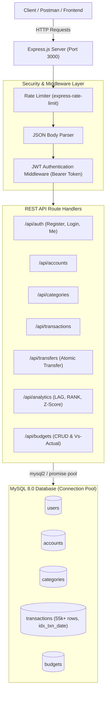
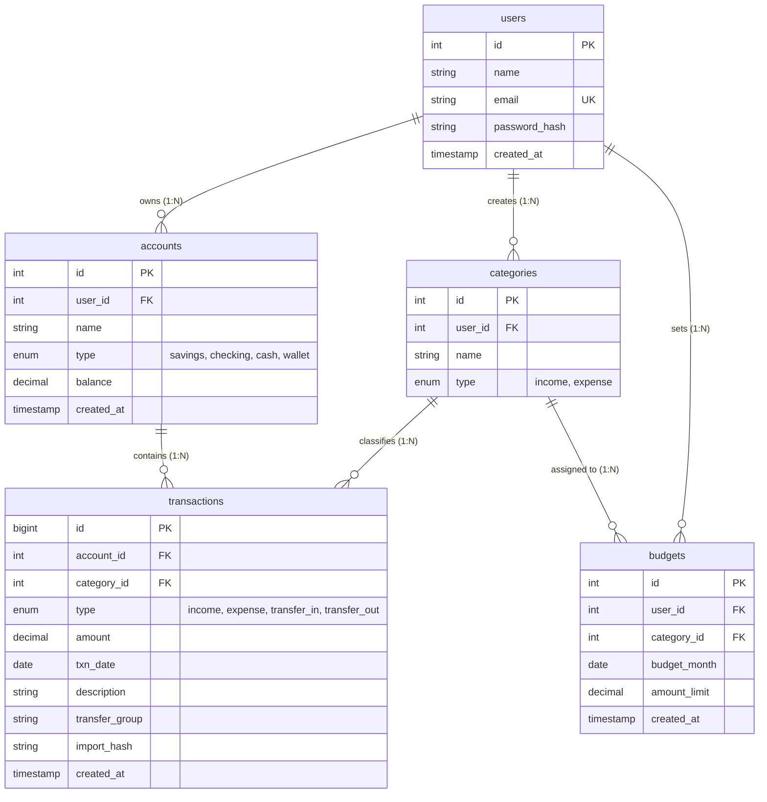
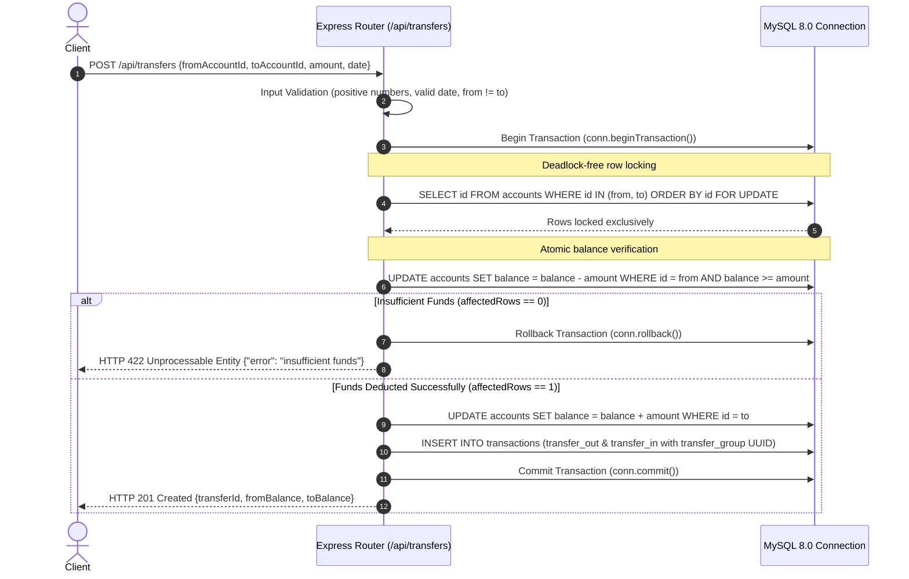

# Personal Finance Tracker API

A production-grade, high-concurrency RESTful API for personal wealth management, budgeting, and financial analytics built with **Node.js**, **Express**, and **MySQL 8.0**.

Designed and benchmarked with **55,000+ realistic transactions**, featuring **atomic fund transfers with row-level locking**, **SQL window function analytics**, and **statistical anomaly detection**.

---

## Key Highlights

- **High-Concurrency Money Transfers**: Prevents race conditions and double-spending via MySQL database transactions (`BEGIN TRANSACTION`), row-level locking (`SELECT ... FOR UPDATE`), and deadlock avoidance (`ORDER BY id`). Stress-tested with **40 parallel transfers** showing **zero balance drift**.
- **In-Database Analytics Engine**: Leverages modern SQL window functions (`LAG`, `RANK`, cumulative `SUM`) and Common Table Expressions (CTEs) to execute complex financial reporting inside MySQL in under **15 ms** without overloading server memory.
- **Statistical Outlier Detection**: Flags unusual transactions using population standard deviation (`STDDEV_POP`) and **Z-Score analysis** ($Z > 3$) to identify spending anomalies.
- **Performance Benchmarked**: Evaluated using `EXPLAIN ANALYZE` on a database with **54,688 rows**. A dedicated B-Tree index on `txn_date` achieved a **4.5x–5x performance speedup** (cutting query execution from ~47 ms to ~10 ms).
- **Multi-Tenant Security**: Enforces complete tenant isolation (`a.user_id = ?`), bcrypt password hashing (10 rounds), signed JWT authentication, parameterized SQL queries, and IP-based rate limiting on sensitive auth endpoints.

---

## System Architecture



---

## Database Entity-Relationship Diagram



---

## Money Transfer Sequence Diagram (Atomic Concurrency Control)



---

## Performance Benchmarks (`EXPLAIN ANALYZE`)

Measured on MySQL 8.0 with **54,688 transactions** using the monthly expense aggregation report:

| Strategy | Query Plan | Rows Scanned | Latency | Disk Overhead | Outcome |
| :--- | :--- | :---: | :---: | :---: | :--- |
| **No Index** | Full Table Scan | 54,688 | **47.0 ms** | 0 MB | Baseline |
| **Composite Index `(type, txn_date)`** | Index Range Scan | 2,081 | **10.6 ms** | ~2.10 MB | Tested and dropped (excess write overhead) |
| **Date Index `(txn_date)`** | Index Range Scan | 2,081 | **10.0 ms** | **1.52 MB** | **Kept (4.5x–5x speedup, lower overhead)** |

*Details and reproducible SQL scripts are preserved in [`database/performance.sql`](database/performance.sql).*

---

## Quick Start & Local Setup (Windows)

### Prerequisites
- [Node.js](https://nodejs.org/) (v18+)
- [MySQL 8.0 Server](https://dev.mysql.com/downloads/mysql/) (Running locally or in MySQL Workbench)
- Git

### 1. Clone & Install Dependencies
```powershell
git clone https://github.com/Sravikumar95/finance_tracker_api.git
cd finance_tracker_api
npm install
```

### 2. Configure Environment Variables
Create a `.env` file in the root directory (based on `.env.example`):
```env
PORT=3000
DB_HOST=localhost
DB_PORT=3306
DB_USER=root
DB_PASSWORD=your_mysql_password
DB_NAME=finance_tracker
JWT_SECRET=your_super_secret_jwt_key
JWT_EXPIRES_IN=1d
```

### 3. Initialize the Database Schema
In MySQL Workbench or the MySQL Command Line Client, execute:
```sql
CREATE DATABASE IF NOT EXISTS finance_tracker;
USE finance_tracker;
SOURCE database/schema.sql;
SOURCE database/performance.sql;
```

### 4. Seed the Database (~55,000 Transactions)
Run the automated seed script to generate 60 users with 24 months of realistic financial activity:
```powershell
node scripts/seed.js
```
*(Seeded credentials: `seed-user-1@example.com` / `password123`)*

### 5. Start the Development Server
```powershell
npm run dev
```
The server will start listening at `http://localhost:3000`.

---

## Verifying Concurrency (40 Parallel Transfers)

Run the included concurrency verification script to test row locking under simultaneous load:
```powershell
node scripts/concurrency-test.js
```
**Test Results**:
- **Scenario 1 (Overdraft protection)**: 20 parallel transfers of \$100 against an account with \$1,000. Exactly 10 succeed (HTTP 201) and 10 fail (HTTP 422). Final balance: **\$0.00** with **zero balance drift**.
- **Scenario 2 (Deadlock avoidance)**: 20 simultaneous cross-transfers (C $\rightarrow$ D and D $\rightarrow$ C). All 20 succeed without deadlocks or server errors.

---

## API Reference

All requests and responses use JSON. Protected routes require the `Authorization: Bearer <token>` header.

### 1. Authentication & System
| Method | Path | Auth | Description |
| :--- | :--- | :---: | :--- |
| `GET` | `/health` | No | System health check (`{"status": "ok"}`) |
| `GET` | `/db-check` | No | Verifies MySQL connection and total user count |
| `POST` | `/api/auth/register` | Rate-Limited | Register a new user (`name`, `email`, `password`) |
| `POST` | `/api/auth/login` | Rate-Limited | Authenticate and obtain JWT token |
| `GET` | `/api/auth/me` | Yes | Get profile of the currently logged-in user |

### 2. Accounts & Categories
| Method | Path | Auth | Description |
| :--- | :--- | :---: | :--- |
| `POST` | `/api/accounts` | Yes | Create an account (`name`, `type: 'savings'\|'checking'\|'cash'\|'wallet'`) |
| `GET` | `/api/accounts` | Yes | List all accounts owned by the user with current balances |
| `POST` | `/api/categories` | Yes | Create a category (`name`, `type: 'income'\|'expense'`) |
| `GET` | `/api/categories` | Yes | List all income and expense categories for the user |

### 3. Transactions & Transfers
| Method | Path | Auth | Description |
| :--- | :--- | :---: | :--- |
| `POST` | `/api/transactions` | Yes | Create income or expense (`accountId`, `type`, `amount`, `date`, `categoryId`) |
| `GET` | `/api/transactions` | Yes | List transactions with pagination (`page`, `limit`) and filters (`from`, `to`, `type`, `accountId`, `categoryId`) |
| `POST` | `/api/transfers` | Yes | Execute atomic transfer with row locking (`fromAccountId`, `toAccountId`, `amount`, `date`) |

### 4. Financial Analytics Engine
| Method | Path | Auth | Description |
| :--- | :--- | :---: | :--- |
| `GET` | `/api/analytics/monthly-summary` | Yes | Monthly income, expense, and net savings (`?from=YYYY-MM&to=YYYY-MM`) |
| `GET` | `/api/analytics/month-over-month` | Yes | MoM spending trend & percentage change using SQL `LAG()` |
| `GET` | `/api/analytics/running-balance` | Yes | Daily cumulative balance using SQL `SUM() OVER` (`?accountId=N&from=...&to=...`) |
| `GET` | `/api/analytics/top-categories` | Yes | Top spending categories per month using SQL `RANK()` (`?month=...&limit=3`) |
| `GET` | `/api/analytics/unusual-transactions` | Yes | Outlier expense detection using statistical Z-Score ($Z > 3$) |

### 5. Budgets & Progress Tracking
| Method | Path | Auth | Description |
| :--- | :--- | :---: | :--- |
| `POST` | `/api/budgets` | Yes | Set monthly budget limit for an expense category (`categoryId`, `month`, `limit`) |
| `GET` | `/api/budgets` | Yes | List all budgets with optional `?month=YYYY-MM` filter |
| `GET` | `/api/budgets/vs-actual` | Yes | Budget vs actual spending comparison with `% used` and `overBudget` flag |
| `PUT` | `/api/budgets/:id` | Yes | Update an existing budget limit |
| `DELETE` | `/api/budgets/:id` | Yes | Delete a budget |
